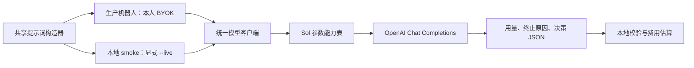

# 个人电脑接续：OpenAI / GPT-6.1 Sol

日期：2026-11-13（北京时间）。先同步最新 main 并检查打开的 PR；这份文档不是生产模型切换授权。用户要求先搭好接入代码，回个人电脑继续验证。

## 当前状态

- #118 已修复 Sol 不支持 temperature 的问题。本批已将参数适配、用量明细、独立重放工具和提示词复用整理为可测试接口。
- 本轮只有离线/模拟响应测试，未调用付费模型。此前真实测试的模型权限查询通过，但生成请求被当前账号额度阻塞，完整决策、实际延迟和实测费用仍未验证。
- 用户说明 $200 赠额在另一个 OpenAI 账号。工作电脑的本地密钥不是那一账号；个人电脑应使用正确账号，通过 OpenAI Developers 安全配置到本机 `.env.local`。不要把密钥、数据库密码或真实上下文提交 Git，也不要把工作电脑的密钥复制过去。
- 生产继续使用原有 Kimi；机器人账户、持仓、订单、BYOK 和策略配置没有被切换。当前默认模型也没有自动从 gpt-4o 改为 Sol。

## 接入结构



| 文件 | 责任 |
| --- | --- |
| `alpha_agent/llm/model_profiles.py` | 已核验的 Sol 参数能力、可选推理档位、带日期的标准价估算；未知模型/非官方地址不猜价格 |
| `alpha_agent/llm/litellm_client.py` | chat、stream、探测共用参数；Sol 显式零重试；保留缓存输入/推理 token 明细 |
| `alpha_agent/llm/_legacy/openai.py` | 旧客户端开关使用相同参数映射，避免回退后再触发 temperature 错误 |
| `alpha_agent/api/byok.py` | 本人凭据解析与客户端构造；本地调用方可显式传 reasoning_effort |
| `alpha_agent/paper/bot_prompt.py` | 纯函数构造生产与重放消息；不读取数据库，不执行交易 |
| `scripts/smoke_openai_paper.py` | 默认离线；`--live` 最多调用一次并校验结果，不运行 worker 或执行动作 |
| `tests/fixtures/openai_paper_smoke.json` | 无真实账户/持仓的合成闭市样例；只测接入，不评价投资质量 |

机器人 SYSTEM 文本、提示词版本和消息序列化保持原样；测试固定原文哈希。新用量字段有默认值，原有调用方兼容。没有新增 HTTP API 或数据库迁移。

Sol 的 `max_completion_tokens=4096` **包括推理与可见回答**。`--reasoning-effort` 可选 low/medium/high/xhigh/max；不传则使用服务商默认档位。此选项目前属于本地重放接口，不是已上线的机器人配置开关。生产机器人依旧使用原请求预算；不要为通过测试自动提高预算或重试。

## 在个人电脑开始

先执行 `git status`、`git fetch origin`，确认本机工作和打开 PR 后再 `git pull --ff-only`，不要覆盖其它开发中的改动。以下命令在仓库根目录运行；已有虚拟环境可直接复用。

```bash
python3 -m venv .venv
.venv/bin/python -m pip install -e '.[dev,storage,test]'
.venv/bin/python scripts/smoke_openai_paper.py
```

预期：`mode=dry_run`、`status=prepared_not_called`、`llm_calls=0`、`orders_submitted=0`。这一步不读密钥、不请求模型或数据库；它不代表已经连通 OpenAI。

在个人电脑完成正确账号的安全密钥配置、确认 API 组织有可用额度后，由用户明确运行：

```bash
.venv/bin/python scripts/smoke_openai_paper.py --live --env-file .env.local
```

此命令固定访问官方 `https://api.openai.com/v1` 和 `gpt-6.1-sol`。若指定 env 文件存在，仅从该文件读 `OPENAI_API_KEY`；该文件不存在才使用同名环境变量。不会使用文件中的其它 API 地址。`.env.local` 仅服务于这个本地工具，不会自动配置生产 BYOK，也不会被普通 `Settings` 的 `.env` 读取逻辑加载。

需要研究 high 档时显式加 `--reasoning-effort high`。先以同一合成输入核验 JSON，再以同一份只读历史上下文比较档位；不要用不同市场快照比较模型能力。

## 真实上下文重放

输入必须是**单条**既有运行的导出对象：

```json
{
  "id": "与 context_id 一致的运行编号",
  "config_snapshot": {"provider": "kimi", "model": "kimi-for-coding"},
  "context": {"context_id": "与 id 一致的运行编号"},
  "llm_calls": 0
}
```

上面只是结构示意，真实测试应保留原始完整 context/config_snapshot，不能用示意内容冒充历史记录。两字段也支持数据库导出时的 JSON 字符串。`llm_calls` 保留原记录计数，避免凭空增加可补研究轮数。用授权的只读查询在个人电脑取得单条记录，放到仓库外、仅本人可读的文件；不要导出整库或凭据表。

```bash
.venv/bin/python scripts/smoke_openai_paper.py --context-file /private/path/run.json
.venv/bin/python scripts/smoke_openai_paper.py --context-file /private/path/run.json --live --env-file .env.local
```

工具只在内存中把 config 的 provider/model 改为测试目标；不写回生产。历史时点仍是历史时点，不伪造成当下。模型建议即使是 rebalance/research，也只检查 JSON，不下单、不补查、不再调用模型。

验收看 `status=valid_decision`、`parse_status=valid`、正确的响应模型和 `finish_reason=stop`，同时记录 token、缓存、推理 token、耗时与 estimated_cost。截断、空回答、上下文错配、未知响应模型、网络/额度失败都非零退出。未知费用返回 null，不当作免费；估算不是账单，推理 token 已包含在 completion_tokens 中，不再重复计费。

## 生产切换前必须知道

当前产品采用**每个用户一个有效 LLM 凭据**。`POST /api/user/byok` 保存新值时会替换同 provider，并删除该用户其它 LLM provider 行；它不是 OpenAI/Kimi 多账号并存功能。设置页“连接测试”可能先保存表单，所以不能用它做无副作用试验。

先用上述本地工具测通，再让用户确认生产凭据替换与机器人配置切换，且确保旧 Kimi 密钥在用户自己的密钥管理中可供回退。当前 Kimi 可能以 provider=openai + api.kimi.com 保存，不能仅看 provider 标签就认为它已经指向 OpenAI。

保存新 BYOK 后，机器人配置仍独立保存 provider/model；仅修改系统 `OPENAI_MODEL` 不会切换机器人。切换时需明确设置官方地址和 `gpt-6.1-sol`，核对配置版本、原持仓、下次运行时间，并等待自然调度。不要为验证强制交易。

如果未来要并存 Kimi/OpenAI 凭据、为不同账户选择凭据或在 UI 配置推理档位，应另做凭据 ID / 配置快照设计与迁移，不能绕过当前单凭据契约。这不属于本批已交付能力。

## 离线回归

```bash
PYTHONPATH=. .venv/bin/python -m pytest tests/test_openai_model_profiles.py tests/test_openai_paper_smoke.py tests/test_litellm_client.py tests/test_byok.py tests/paper/test_bot_prompt.py tests/paper/test_bot_last_used.py tests/paper/test_bot_current_ranking.py tests/paper/test_bot_output_contract.py -q
```

上述目标测试不调用付费模型。完整 CI 与部署回执以对应 PR 为准；不要把合成输入测试或模型连通当作策略盈利验证。OpenAI 参考：[模型参数与价格](https://developers.openai.com/api/docs/models/gpt-6.1-sol)、[订阅额度规则](https://developers.openai.com/api/docs/guides/chatgpt-api-credits)。
